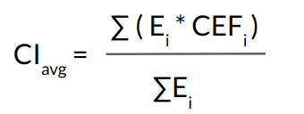

# CarbonCast
CarbonCast: Multi-Day Forecasting of Grid Carbon Intensity
([PDF](https://groups.cs.umass.edu/ramesh/wp-content/uploads/sites/3/2022/09/buildsys2022-final282.pdf)). An extended version of our paper appeared in ACM SIGEnergy Energy Informatics Review, and can be found [here](https://energy.acm.org/eir/multi-day-forecasting-of-electric-grid-carbon-intensity-using-machine-learning/).
<br>
CarbonCast provides average carbon intensity forecasts for up to 96 hours. This is an extension of [DACF](https://github.com/carbonfirst/DACF), which provides only day-ahead carbon intensity forecasts.

Version: 2.1 <br>
Authors: Diptyaroop Maji, Prashant Shenoy, Ramesh K Sitaraman <br>
Affiliation: University of Massachusetts, Amherst

<b>CarbonCast v3.0, which can provide forecasts in real-time, is now in the testing phase and can be found [here](https://github.com/carbonfirst/CarbonCast/tree/v3.0_real_time_service). Please feel free to use and report any issues. We are working to release it in the main branch soon.</b>


<!-- ## CarbonCast Architecture
### First tier
### Second Tier
-->

<!-- [TODO:] Update readme about weather, config, cef etc.. Include weather src files, update data files. -->
## 0. Disclaimer
We will be periodically updating this repo as we update/improve/extend CarbonCast. Even after cloning the repo, please check back in a while to see if anything is updated. <br>
If something is not working, please check whether some recent update has already fixed that. <br>
In case something is not working in the latest version, or if there are any doubts/questions/suggestions, please feel free to reach us at dmaji at cs dot umass dot edu.

### 0.1 Current status:
Code files: Up to date as of 03/11/2023. Updated in 10/2026 to run on current Python / TensorFlow / pandas versions (see Section 9). <br>
Data files: Up to date as of 01/10/2023. <br>
Latest stable commit: <br>

## Quick Start (step by step, no prior experience needed)

This walks you through getting **96-hour carbon intensity forecasts** using the data and trained models that are already included in this repository. You need about 3 GB of free disk space and an internet connection for the installation. Expect the installation to take 5–10 minutes and each region to take about 1 minute to forecast.

**Supported systems:** macOS on Apple Silicon (M1/M2/M3/M4…), Linux (64-bit), Windows 10/11 (64-bit). <br>
**Not supported:** Intel-based Macs (current TensorFlow releases no longer support them).

### Step 1 — Install Python
CarbonCast needs **Python 3.11, 3.12 or 3.13** (Python 3.14 is not yet supported by TensorFlow).

* **macOS:** download the installer for Python 3.12 from [python.org/downloads/macos](https://www.python.org/downloads/macos/) and run it. (Or, if you use Homebrew: `brew install python@3.12`.)
* **Windows:** download Python 3.12 from [python.org/downloads/windows](https://www.python.org/downloads/windows/). In the installer, **tick "Add python.exe to PATH"** before clicking *Install Now*.
* **Linux (Ubuntu/Debian):** `sudo apt install python3 python3-venv python3-pip` (check `python3 --version` is 3.11 or newer).

To check it worked, open a terminal (macOS: *Terminal* app; Windows: *Command Prompt*) and type:

```bash
python3 --version
```

(On Windows, type `py --version` instead.) It should print `Python 3.11.x`, `3.12.x` or `3.13.x`.

### Step 2 — Get the code
Either download the repository as a ZIP from GitHub (green **Code** button → **Download ZIP**) and unzip it, or use git:

```bash
git clone https://github.com/carbonfirst/CarbonCast.git
```

Then move into the folder in your terminal (replace the path with wherever you put it):

```bash
cd CarbonCast
```

### Step 3 — Create an isolated Python environment and install the dependencies
This keeps CarbonCast's packages separate from the rest of your computer. Run these commands **from inside the `CarbonCast` folder**.

macOS / Linux:

```bash
python3 -m venv .venv
```

```bash
source .venv/bin/activate
```

```bash
pip install --upgrade pip
```

```bash
pip install -r requirements.txt
```

Windows (Command Prompt):

```bash
py -3.12 -m venv .venv
```

```bash
.venv\Scripts\activate
```

```bash
python -m pip install --upgrade pip
```

```bash
pip install -r requirements.txt
```

After activation, your prompt starts with `(.venv)`. **Every time you open a new terminal** to use CarbonCast, `cd` into the folder and run the `activate` command again (no need to reinstall).

### Step 4 — Run CarbonCast with the included models
All CarbonCast scripts must be run from inside the `src` folder:

```bash
cd src
```

Get forecasts using **lifecycle** emission factors (`-l`) with the **saved** models (`-s`):

```bash
python secondTierForecasts.py secondTierConfig.json -l -s
```

Or using **direct** emission factors:

```bash
python secondTierForecasts.py secondTierConfig.json -d -s
```

TensorFlow prints some informational messages and a harmless `UserWarning` about `input_shape` at the start; these can be ignored. A run ends with the line `End`. For each region you will see the forecast accuracy, e.g.:

```
[BESTMODEL] Overall MAPE score:  7.991865
Prediction day  1 ( 0  -  24  hrs)
Mean MAPE:  6.003...
...
#################### NL  done ####################
```

MAPE is the mean absolute percentage error of the forecast vs. the real carbon intensity (lower is better), reported overall and for each of the 4 forecast days.

### Step 5 — Choose regions and save the forecasts to a file
Open `src/secondTierConfig.json` in any text editor:

* `"REGION": ["NL", "AUS_QLD"]` — the regions to forecast. You can list any of: `CISO, PJM, ERCO, ISNE, NYISO, FPL, BPAT, SE, DE, ES, NL, PL, AUS_QLD` (see Section 1).
* `"WRITE_CI_FORECASTS_TO_FILE": "False"` — change to `"True"` to save the hourly actual vs. forecast carbon intensity to `CI_forecast_data/<REGION>/<REGION>_<lifecycle|direct>_96hr_CI_forecasts_0.csv` (the folder is created automatically).

Save the file and run the command from Step 4 again.

### Troubleshooting
* **`python3: command not found` / `'python' is not recognized`** — Python is not installed or not on your PATH; redo Step 1 (on Windows make sure "Add python.exe to PATH" was ticked).
* **`No matching distribution found for tensorflow==...`** — your Python version is not 3.11–3.13, or you are on an Intel Mac / 32-bit system. Check with `python --version`.
* **`ModuleNotFoundError: No module named 'tensorflow'` (or `pandas`, …)** — the environment is not active. Run the `activate` command from Step 3.
* **`FileNotFoundError: ... ../data/...`** — you are not in the `src` folder. Run `cd src` (from the `CarbonCast` folder) first.
* To hide TensorFlow's informational log lines, set `TF_CPP_MIN_LOG_LEVEL=2` (macOS/Linux: `export TF_CPP_MIN_LOG_LEVEL=2`; Windows: `set TF_CPP_MIN_LOG_LEVEL=2`).

## 1. Regions covered 
* US (US region data collected from [EIA](https://www.eia.gov/electricity/gridmonitor/dashboard/electric_overview/US48/US48)):
    * California ([CISO](https://www.caiso.com/Pages/default.aspx))
    * Florida ([FPL](https://www.fpl.com/))
    * New England ([ISO-NE](https://www.iso-ne.com/). We refer the region as ISNE.)
    * New York ([NYISO](https://www.nyiso.com/))
    * Pennsylvania-Jersey-Maryland Interconnection ([PJM](https://www.pjm.com/))
    * Texas ([ERCOT](https://www.ercot.com/). We refer the region as ERCO)
    * Washington ([BPAT](https://www.bpa.gov/))
* Europe (European regions are monitored by [ENTSOE](https://transparency.entsoe.eu/)):
    * Germany (DE)
    * Netherlands (NL)
    * Spain (ES)
    * Sweden (SE)
    * Poland (PL)
* Australia (Data for Australian regions is available at [OpenNEM](https://opennem.org.au/energy/nem/?range=7d&interval=30m))
    * Queensland (AUS-QLD)
<!-- * Canada
    * Ontario ([IESO](). We refer the region as CA_ON) -->

## 2. Data Sources
US ISO electricity generation by source: [EIA hourly grid monitor](https://www.eia.gov/electricity/gridmonitor/dashboard/electric_overview/US48/US48)

European regions electricity generation by source: [ENTSOE](https://transparency.entsoe.eu/)

Australian regions electricity generation by source: [OpenNEM](https://opennem.org.au/energy/nem/?range=7d&interval=30m)

Weather forecasts: [GFS weather forecast archive](https://rda.ucar.edu/datasets/ds084.1/)

Day-ahead solar/wind Forecasts:
* CISO: [OASIS](http://oasis.caiso.com/mrioasis/logon.do)
* European regions: [ENTSOE](https://transparency.entsoe.eu/)
* We currently do not have solar/wind forecasts for other regions, or for periods beyond 24 hours. Hence, we generate them using ANN models along with 96-hour forecasts for other sources.

## 3. Background on carbon intensity

### 3.1 Carbon emission factor (CEF):
CEF of a source is the amount of carbon emitted into the atmosphere per unit of electricity generated by that source. There can be two types of CEFs for a source: <br>
* Direct emission factors: These are the operational emissions when a source is converted into electricity. <br>
* Lifecycle emission factors: These include operational as well as infrastructural emissions up the supply chain. <br>
(See paper for further details.)

### 3.2 Calculating average carbon intensity:
We use the following formula for calculating avg carbon intensity:<br>
    , where <br>
<br>
<i>CI<sub>avg</sub></i> = Average carbon intensity (real-time or forecast) of a region <br>
<i>E<sub>i</sub></i> = Electricity produced by source i. <br>
<i>CEF<sub>i</sub></i> = Carbon emission factor (lifecycle/direct) of source i. <br>

We have provided the file ``` carbonIntensityCalculator.py ``` to calculate both real-time/historical average CI values as well as carbon intensity forecasts from source prodution forecasts. Please refer to Section 4.4 for details.

## 4. Running CarbonCast with existing datasets and models

### 4.1 Installing dependencies:
CarbonCast requires Python 3.11 – 3.13 (tested with Python 3.11). <br>
Other required packages:
* Required python modules (TensorFlow 2.21 / Keras 3, pandas 3, NumPy 2, …) are listed in ```requirements.txt```.<br>
Create a virtual environment and install them as described in the [Quick Start](#quick-start-step-by-step-no-prior-experience-needed) (Step 3), i.e. ```python3 -m venv .venv```, ```source .venv/bin/activate```, ```pip install -r requirements.txt```.
* wgrib2 (only needed for collecting new weather data, Section 5.1). Please refer [here](https://www.cpc.ncep.noaa.gov/products/wesley/wgrib2/compile_questions.html) for compilation/installation details. If you are using MacOS and having trouble compiling wgrib2, please refer to [this](https://theweatherguy.net/blog/weather-links-info/how-to-install-and-compile-wgrib2-on-mac-os-10-14-6-mojave/) article. A pre-built wgrib2 is also available from conda-forge (```conda install -c conda-forge wgrib2```). Once wgrib2 is compiled, go to the grib2 directory and run the following command to access wgrib2 from anywhere in the terminal:
```cp -rfv wgrib2/wgrib2 /usr/local/bin/wgrib2```
<!-- * ``` pip3 install numpy, matplotlib, sklearn, datetime, matplotlib ``` -->

**All commands below must be run from the ```src/``` directory with the virtual environment activated** (file paths in the configuration files are relative to ```src/```).

### 4.2 Running CarbonCast using saved models/Reproducing results from paper:
We have saved second-tier models for each region which you can use with existing & new datasets to get 96-hour CI forecasts. These models are trained with data from Jan-Dec 2020 and validated with data from Jan-Jun 2021, so that results similar to the paper can be obtained when tested over Jul-Dec 2021. Each region has 2 saved models --- one for lifecycle CEF & the other for direct CEF. If you are using new datasets, you may need to update the models with new training data or generate new models.<br>
To run CarbonCast using the saved model for any region, run: <br>
```python3 secondTierForecasts.py <configFileName> <-l/-d> <-s>```<br>
<b>Configuration file name:</b> <i>secondTierConfig.json</i> <br>
<b>Regions:</b> <i>CISO, PJM, ERCO, ISNE, NYISO, FPL, BPAT, SE, DE, ES, NL, PL, AUS_QLD.</i> You can specify the region(s) in the configuration file. <br>
<b><-l/-d>:</b> <i>Lifecycle/Direct.</i> Relevant saved model for the specified region(s) will be loaded.<br>
<b><-s>: </b> <i>Use saved model.</i> Parameter that tells CarbonCast to use saved models and not train a new model.


## 5 Running CarbonCast from scratch
To run CarbonCast from scratch (with new data/for new regions etc.), first install the dependencies mentioned in Section 4.1.

### 5.1 Getting Weather data:
The aggregated and cleaned weather forecasts that we have used for our regions are provided in ```data/```. If you need weather forecasts for other regions, or even for the same regions (e.g., if you want to use a different aggregation method or if you want to forecast for a different time period), the procedure is mentioned below.<br>
* We fetch weather data from the [GFS weather forecast archive](https://rda.ucar.edu/datasets/ds084.1/). You will need to register 
before you can get weather data. Once you have registered, do the following:
* GitHub repo of script to fetch weather data can be found [here](https://github.com/NCAR/rda-apps-clients). You can follow the instructions there and download weather forecasts in grib2 format. The repo has a sample [Jupyter Notebook](https://github.com/NCAR/rda-apps-clients/blob/main/src/python/rdams_client_example.ipynb) with step-by-step instructions. Remember to modify the notebook as required (e.g., changing the dataset id (dsid)).
* Otherwise, clone the above repo and add the following two files in the ```rda-apps-clients/src/python``` folder: <br>
    ``` src/weather/getWeatherData.py,  src/weather/ds084.1_control.ctl ``` <br>
```getWeatherData.py``` uses ``` ds084.1_control.ctl ``` as a template file to download 96-hour weather forecasting data for a particular region. Change the template file for different regions and weather variables (weather variables include wind speed, temperature, dewpoint temperature, solar irradiance (dswrf), and precipitation). The template file has instructions on how to modify it for different regions and weather variables. After you have configured the template file, run: ```python3 getWeatherData.py```<br>
* You may need to add your credentials in ```rda-apps-clients/src/python/rdams_client.py``` for API calls to work. To do that, add the following as the first line in ```get_authentication()```:<br>
```write_pw_file(<username>, <password>)```
* Once you have obtained the grib2 files, use the following files to aggregate and clean the data:<br>
```python3 dataCollectionScript.py``` -- this file uses code from [here](https://towardsdatascience.com/the-correct-way-to-average-the-globe-92ceecd172b7) for aggregating weather forecasts over a specified region. <br>
```python3 cleanWeatherData.py``` -- this file cleans the data and generates hourly files for the above specified weather variables.<br>
You will need to modify the relevant fields in the above two files to successfully parse & clean the weather data. <br>
In ```dataCollectionScript.py``` these are ```ISO_LIST```, ```GRIB2_CMD``` (path to your wgrib2 binary, e.g. ```"wgrib2"``` if it is on your PATH), ```YEARS``` and the ```FILE_DIR``` / ```OUT_FILE_NAME_LIST``` paths at the bottom of the file. In ```cleanWeatherData.py``` these are ```ISO``` and ```FILE_DIR``` (the folder containing the ```<ISO>_AVG_*.csv``` files produced by ```dataCollectionScript.py```). Both scripts start working as soon as they are run, so edit them first. <br>
Note: newer versions of ```rda-apps-clients``` / ```rdams_client``` may authenticate with an API token instead of a username/password; follow the instructions in that repository for authentication. <br>
If you are using any other weather aggregating method, please feel free to modify the above files as required.

### 5.2 Getting source production forecasts:
You will need to obtain, clean, & format the datasets before you can get source production forecasts. You may also need to modify the configuration file as required.<br>
For getting source production forecasts in the first-tier, run the following file:<br>
```python3 firstTierForecasts.py <configFileName> ```<br>
<b>Configuration file name:</b> <i>firstTierConfig.json</i> <br>
<b>Regions:</b> <i>CISO, PJM, ERCO, ISNE, NYISO, FPL, BPAT, SE, DE, ES, NL, PL, AUS_QLD</i> <br>
<b>Sources:</b> <i>coal, nat_gas, oil, solar, wind, hydro, unknown, geothermal, biomass, nuclear</i> <br>
You can get source production forecasts of multiple regions together. Just add the new regions in the "REGION" parameter.<br>
Training runs for every source, period and experiment in the configuration file, which takes a long time (hours for a full region). For a quick test, reduce ```"EPOCH"```, the number of sources or the ```"TRAIN_TEST_PERIOD"``` entries in the configuration file. Forecasts are written to ```data/<REGION>/fuel_forecast/<REGION>_ANN_DA_<source>_iter<N>.csv```.
<!-- A detailed description of how to configure is given in Section 3.5 -->

### 5.3 Calculating carbon intensity (real-time/historical/from source production forecasts):
For calculating real-time/historical carbon intensity from source data, or carbon intensity forecasts from the source production forecast data using the formula, run the following file: <br>
```python3 carbonIntensityCalculator.py <region> <-l/-d> <-f/-r> <num_sources>```<br>
<b>Regions:</b> <i>CISO, PJM, ERCO, ISNE, NYISO, FPL, BPAT, SE, DE, ES, NL, PL, AUS_QLD</i> <br>
<b><-l/-d>:</b> <i>Lifecycle/Direct</i> <br>
<b><-f/-r>:</b> <i>Forecast/Real-time (or, historical)</i> <br>
<b>num_sources:</b> <i>No. of electricity producting sources in that region.</i> <br>
Example (forecast mode works with the data included in the repo): ```python carbonIntensityCalculator.py CISO -l -f 8``` <br>
Forecast mode (```-f```) reads ```data/<REGION>/<REGION>_carbon_<lifecycle|direct>_Jul_Dec_2021.csv``` and ```data/<REGION>/<REGION>_96hr_source_prod_forecasts_DA_Jul_Dec_2021.csv```, which are included. Real-time mode (```-r```) reads the raw hourly source-production file ```data/<REGION>/<REGION>.csv``` (columns: ```UTC time```, then one column per source), which is **not** included; you need to provide it yourself. As noted at the top of the file, writing the results to CSV is commented out; uncomment the ```to_csv``` lines if you need the output files. <br>

### 5.4 Getting carbon intensity forecasts using CarbonCast:
For getting 96-hour average carbon intensity forecasts, run the following file: <br>
```python3 secondTierForecasts.py <configFileName> <-l/-d>```<br>
<b>Configuration file name:</b> <i>secondTierConfig.json</i> <br>
<b>Regions:</b> <i>CISO, PJM, ERCO, ISNE, NYISO, FPL, BPAT, SE, DE, ES, NL, PL, AUS_QLD</i> <br>
<b><-l/-d>:</b> <i>Lifecycle/Direct</i> <br>
You can get carbon intensity forecasts of multiple regions together. Just add the new regions in the "REGION" parameter.<br>
Without ```-s```, a new CNN-LSTM model is trained ```NUMBER_OF_EXPERIMENTS_PER_REGION``` times per region (up to 100 epochs each, a few minutes per experiment on a laptop CPU). The best model of each experiment is saved as ```src/<REGION>_best_model_iter<N>.h5```; to reuse one with ```-s```, copy it to ```saved_second_tier_models/<lifecycle|direct>/<REGION>.h5```.

<!-- ### 3.5 Configuring CarbonCast:
Change the firstTierConfig.json and secondTierConfig.json files for desired configurations. Below are the fields used in the file along with their meaning:<br>
PREDICTION_WINDOW_HOURS: Prediction window in hours. (Default: 96) -->

## 6. Developer mode

We welcome users to suggest modifications to improve CarbonCast and/or add new features or models to the existing codebase. Please feel free to contact us at dmaji at cs dot umass dot edu with suggestions (or even working patches!)
<!-- Use the developer branch to make edits and submit a change. -->

## 7. Citing CarbonCast
If you use CarbonCast, please consider citing our paper. The BibTex format is as follows: <br>
&nbsp; &nbsp; &nbsp; &nbsp;@inproceedings{maji2022carboncast,<br>
&nbsp; &nbsp; &nbsp; &nbsp;  title={CarbonCast: multi-day forecasting of grid carbon intensity},<br>
&nbsp; &nbsp; &nbsp; &nbsp;  author={Maji, Diptyaroop and Shenoy, Prashant and Sitaraman, Ramesh K},<br>
&nbsp; &nbsp; &nbsp; &nbsp;  booktitle={Proceedings of the 9th ACM International Conference on Systems for Energy-Efficient Buildings, Cities, and Transportation},<br>
&nbsp; &nbsp; &nbsp; &nbsp;  pages={198--207},<br>
&nbsp; &nbsp; &nbsp; &nbsp;  year={2022}<br>
&nbsp; &nbsp; &nbsp; &nbsp;}<br>

## 8. Acknowledgements
This work is part of the [CarbonFirst](http://carbonfirst.org/) project, supported by NSF grants 2105494, 2021693, and 2020888, and a grant from VMware.

## 9. Compatibility update (modern Python / TensorFlow / pandas)
The code was originally written for Python 3.9, TensorFlow/Keras 2.9, pandas 1.4 and NumPy 1.23, which can no longer be installed on current systems (e.g. Apple Silicon Macs, Python ≥ 3.11). It has been updated to run on Python 3.11–3.13 with TensorFlow 2.21 / Keras 3, pandas 3, NumPy 2 and current versions of the other libraries. **The models, features, hyperparameters and forecasting methodology are unchanged**; only code that failed or silently misbehaved on the new library versions was modified:

* **Keras 3:** imports from the removed modules ```keras.layers.convolutional``` / ```keras.layers.core``` now import from ```keras.layers```. Models are loaded with ```common.load_model()```, which lets Keras 3 read the ```.h5``` models saved by TensorFlow 2.9 (it ignores the obsolete LSTM ```time_major``` option, and skips restoring the optimizer/loss, which is not needed because loaded models are only used for prediction). The included saved models load and run for all 13 regions.
* **pandas 3:** removed the deprecated ```infer_datetime_format``` argument (pandas now always infers the date format). Arrays that the code modifies in place are now explicit copies (```to_numpy(copy=True)```), because pandas now returns read-only arrays. Chained assignments such as ```df[col].iloc[i] = v``` (in ```weather/cleanWeatherData.py```) and the negative-value clipping in ```carbonIntensityCalculator.py``` silently stopped modifying the data under pandas' Copy-on-Write; they were rewritten to modify the DataFrame directly. ```Series[0]``` positional access was changed to ```.iloc[..., 0]```.
* **NumPy 2:** ```np.float``` → ```np.float64```.
* **Other:** removed unused imports that no longer exist or needed extra packages (```scipy.fftpack.ss_diff```, ```scipy.sparse.data```, ```xarray```); seaborn's ```scale=``` argument renamed to ```density_norm=```; the output folder for CI forecast files is created automatically; ```tensorflow-macos``` is no longer needed on Apple Silicon (the standard ```tensorflow``` package supports it).
